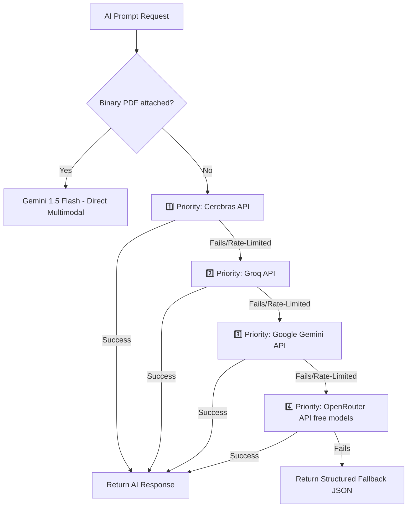

# 📖 Oratii (Vocalize) — Complete Technical Documentation

> **Oratii (Vocalize)** is an AI-powered communication coaching platform built with Next.js 14 (App Router). It empowers users to overcome glossophobia and master public speaking, presentation skills, interview readiness, and academic viva defense through real-time AI evaluation, multimodal slide analysis, interactive Q&A examiners, gamified progress tracks, and a resilient multi-AI fallback architecture.

---

## 📋 Table of Contents

- [Tech Stack](#tech-stack)
- [Getting Started](#getting-started)
- [Project Structure](#project-structure)
- [Architecture Overview](#architecture-overview)
- [Multi-AI Fallback Cascade System](#multi-ai-fallback-cascade-system)
- [Core Features & Modules](#core-features--modules)
  - [1. Speech Coach](#1-speech-coach-speech-coach)
  - [2. Slide Deck & Presentation Analyzer](#2-slide-deck--presentation-analyzer-presentation)
  - [3. AI Viva Defense Examiner](#3-ai-viva-defense-examiner-viva)
  - [4. 20-Day Public Speaking Challenge](#4-20-day-public-speaking-challenge-challenge)
  - [5. User Dashboard & Analytics](#5-user-dashboard--analytics-dashboard)
  - [6. Reports & PDF Export](#6-reports--pdf-export-reports)
  - [7. Admin Dashboard & Sub-Modules](#7-admin-dashboard--sub-modules-admin)
- [API Routes Reference](#api-routes-reference)
- [Database Schema & Migrations](#database-schema--migrations)
- [Authentication & Role Management](#authentication--role-management)
- [Gamification System](#gamification-system)
- [Billing, Usage Enforcement & Free Upgrade](#billing-usage-enforcement--free-upgrade)
- [Components Reference](#components-reference)
- [Library Utilities Reference](#library-utilities-reference)
- [Configuration Files](#configuration-files)
- [Testing & Quality Assurance](#testing--quality-assurance)
- [Environment Variables](#environment-variables)
- [Notable Software Patterns & Conventions](#notable-software-patterns--conventions)

---

## Tech Stack

| Layer | Technology |
| :--- | :--- |
| **Framework** | Next.js 14.2.1 (App Router, React 18, Server & Client Components) |
| **Language** | TypeScript (ES2017+) |
| **Styling** | Tailwind CSS 3.4.1, Autoprefixer, PostCSS, Custom CSS Keyframes |
| **Auth & Database** | Supabase (PostgreSQL, Row Level Security, Auth Services, Triggers) |
| **Primary AI Models** | Google Gemini 1.5 Flash (Multimodal Text/Vision), Deepgram Nova-2 (STT) |
| **Multi-AI Fallback Engine** | Cerebras (`llama-3.3-70b`), Groq, Google Gemini, OpenRouter (`free` fallback) |
| **Client Vision ML** | MediaPipe Tasks Vision (GPU-accelerated in-browser eye contact & posture tracking) |
| **Payments** | Razorpay (Checkout SDK, API order generation, HMAC Webhook verification) |
| **Email** | Resend API (Transactional payment & auth notifications) |
| **File Processing** | `pdf.js` (client CDN), `JSZip` (PPTX parsing), `pdf-parse` (server), ConvertAPI (PPTX→PDF) |
| **Audio/Video Media** | `react-webcam`, `RecordRTC` (Blob recording), IndexedDB |
| **Data Visualization** | Recharts (Responsive area, bar, and timeline charts) |
| **PDF Generation** | `jsPDF` + `html2canvas` |
| **Error Monitoring** | Sentry (`@sentry/nextjs`) client & server instrumentation |
| **Testing** | Jest + React Testing Library (Unit), Playwright (E2E) |

---

## Getting Started

### Prerequisites

- **Node.js** ≥ 18.x
- **npm** ≥ 9.x
- **Supabase Project** (Auth + PostgreSQL)
- **API Keys**: Gemini, Deepgram, Cerebras, Groq, OpenRouter, Razorpay, ConvertAPI, Resend, Sentry

### Installation

```bash
# Clone the repository
git clone <repo-url>
cd ppt-analyzer

# Install project dependencies
npm install

# Copy environment template & set your API keys
cp .env.local.example .env.local

# Run Next.js local development server
npm run dev
```

Open `http://localhost:3000` in your browser.

### Available npm Scripts

| Script | Command | Description |
| :--- | :--- | :--- |
| `dev` | `next dev` | Start Next.js local dev server |
| `build` | `next build` | Create production bundle |
| `start` | `next start` | Launch production server |
| `lint` | `next lint` | Run ESLint static code analysis |
| `test` | `jest` | Run Jest unit tests |
| `test:watch` | `jest --watch` | Run Jest tests in interactive watch mode |

---

## Project Structure

```
ppt-analyzer/
├── public/                         # Static public assets (favicons, graphics)
├── supabase/
│   └── migrations/                 # Complete SQL migrations chain
│       ├── 01_billing_schema.sql   # Profiles, Subscriptions, Payments & Limits tables
│       ├── 02_profile_avatar.sql   # Avatar URL column addition
│       ├── 03_row_level_security.sql # Production RLS policies & trigger security
│       └── 04_add_session_data.sql # Session metrics & recording metadata columns
├── src/
│   ├── app/                        # Next.js App Router Pages & API Routes
│   │   ├── api/                    # Serverless API routes (12 endpoints)
│   │   │   ├── analyze-body-language/route.ts # Gemini Vision body posture endpoint
│   │   │   ├── analyze-slides/route.ts        # Slide deck evaluation endpoint
│   │   │   ├── auth/                          # Custom Auth Endpoints
│   │   │   │   ├── login/route.ts
│   │   │   │   └── signup/route.ts
│   │   │   ├── convert-pptx/route.ts          # ConvertAPI PPTX to PDF converter
│   │   │   ├── free-upgrade/route.ts          # Free tier upgrade / promo claim
│   │   │   ├── make-admin/route.ts            # Admin role assignment endpoint
│   │   │   ├── razorpay/
│   │   │   │   └── create-order/route.ts      # Razorpay order generator
│   │   │   ├── speech-analyzer/route.ts       # Deepgram STT transcription
│   │   │   ├── speech-analyzer-deep/route.ts  # Multi-AI tone & pace evaluator
│   │   │   ├── speech-writer/route.ts         # AI topic speech generator
│   │   │   ├── viva/route.ts                  # AI Viva defense examiner backend
│   │   │   └── webhooks/
│   │   │       └── razorpay/route.ts          # Razorpay payment confirmation webhook
│   │   ├── about/                  # About Us page
│   │   ├── account/                # User Account & Profile Settings
│   │   ├── admin/                  # Protected Admin Dashboard
│   │   │   ├── feedback/tickets/   # Support tickets & feedback management
│   │   │   ├── speech/             # Speech Coach analytics & session logs
│   │   │   │   └── analytics/
│   │   │   ├── subscriptions/      # Subscription & payment logs
│   │   │   │   └── payments/
│   │   │   ├── users/              # User management panel
│   │   │   └── viva/               # Viva session management & Question bank
│   │   │       └── questions/
│   │   ├── challenge/              # 20-Day Gamified Challenge curriculum
│   │   ├── dashboard/              # User Dashboard & Performance Analytics
│   │   │   └── billing/            # Billing overview & subscription management
│   │   ├── feedback/               # User feedback submission page
│   │   ├── forgot-password/        # Password reset email request
│   │   ├── login/                  # User login page (Email + Google OAuth)
│   │   ├── make-me-admin/          # Secret admin role bootstrap page
│   │   ├── presentation/           # Slide Deck & Presentation Analyzer
│   │   ├── pricing/                # Plan comparison & Razorpay checkout
│   │   ├── privacy/                # Privacy Policy
│   │   ├── profile/                # User profile overview
│   │   ├── reports/                # Session Breakdown & PDF Export engine
│   │   ├── reset-password/         # New password confirmation page
│   │   ├── sentry-test/            # Sentry integration test route
│   │   ├── signup/                 # Registration page
│   │   ├── speech-coach/           # Speech Coach practice studio
│   │   ├── support/                # Help desk & ticket submission
│   │   ├── terms/                  # Terms of Service
│   │   ├── viva/                   # Interactive Viva Defense Examiner
│   │   ├── HomeClient.tsx          # Landing page interactive client component
│   │   ├── layout.tsx              # Root HTML & body wrapper
│   │   ├── page.tsx                # Home page server route
│   │   ├── globals.css             # Tailwind base & custom animations
│   │   ├── global-error.tsx        # Sentry error boundary
│   │   ├── robots.ts               # Automated SEO robots.txt handler
│   │   └── sitemap.ts              # Automated SEO sitemap generator
│   ├── components/                 # UI Component Library
│   │   ├── admin/                  # Admin layout, headers & sidebars
│   │   │   ├── AdminHeader.tsx
│   │   │   ├── AdminSidebar.tsx
│   │   │   └── ThemeProvider.tsx
│   │   ├── AdminLogin.tsx
│   │   ├── BadgeGrid.tsx
│   │   ├── CertificateModal.tsx
│   │   ├── ConfidenceGraph.tsx
│   │   ├── EmptyState.tsx
│   │   ├── Footer.tsx
│   │   ├── ImprovementRoadmap.tsx
│   │   ├── JuryAvatar.tsx
│   │   ├── LiveAlert.tsx
│   │   ├── RecommendationCard.tsx
│   │   ├── ScribbleLoader.tsx
│   │   ├── ScrollReveal.tsx
│   │   ├── SidebarLayout.tsx
│   │   ├── StreakBadge.tsx
│   │   ├── TimelineEvent.tsx
│   │   ├── TrialSignupPrompt.tsx
│   │   ├── UpgradeModal.tsx
│   │   ├── XPBar.tsx
│   │   └── XPToast.tsx
│   ├── lib/                        # Business Logic & Core Infrastructure
│   │   ├── __tests__/              # Jest unit test suites
│   │   ├── admin/                  # Admin data definitions & metrics
│   │   │   └── data.ts
│   │   ├── aiFallback.ts           # 🛡️ Multi-AI provider failover system
│   │   ├── billing.ts              # Subscription limit verification logic
│   │   ├── challenge.ts            # Challenge curriculum data & handlers
│   │   ├── constants.ts            # Scoring rules, personas, filler words list
│   │   ├── email.ts                # Resend transactional email helper
│   │   ├── fetchWithRetry.ts       # Exponential backoff network wrapper
│   │   ├── gamification.ts         # XP calculation, level progression & badges
│   │   ├── mediapipeLoader.ts      # Web-based MediaPipe gesture recognizer
│   │   ├── playSound.ts            # Gamification web audio sound effects
│   │   ├── presentationConverter.ts# Client/server PPTX & PDF extractors
│   │   ├── rateLimit.ts            # API rate limiting engine
│   │   ├── razorpay.ts             # Client payment modal script launcher
│   │   ├── sessionRecorder.ts      # Audio/video event recording framework
│   │   ├── storage.ts              # Unified LocalStorage + Supabase sync layer
│   │   ├── supabaseClient.ts       # Supabase browser singleton
│   │   ├── trialManager.ts         # Local trial tracking manager
│   │   ├── videoFrameExtractor.ts  # Video blob frame sampler for vision AI
│   │   └── videoStorage.ts         # IndexedDB video blob repository
│   ├── instrumentation.ts          # Sentry server-side setup
│   └── instrumentation-client.ts   # Sentry client-side monitoring setup
├── tests/                          # Playwright end-to-end integration tests
│   ├── example.spec.ts
│   └── navigation.spec.ts
├── package.json
├── next.config.mjs
├── tailwind.config.js
├── tsconfig.json
├── jest.config.mjs
├── jest.setup.js
├── playwright.config.ts
└── global.d.ts
```

---

## Architecture Overview

### Client & Server Data Flow Architecture

```
┌──────────────────────────────────────────────────────────────────┐
│                        CLIENT (Browser)                          │
│                                                                  │
│  ┌─────────────┐  ┌────────────┐  ┌────────────┐  ┌──────────┐ │
│  │ localStorage │  │ IndexedDB  │  │sessionStore│  │MediaPipe │ │
│  │ (XP, badges, │  │ (Video     │  │(Viva state)│  │(Gestures)│ │
│  │  streaks,    │  │  recordings│  │            │  │ GPU accel│ │
│  │  sessions)   │  │  max 5)    │  │            │  │          │ │
│  └──────┬───────┘  └─────┬──────┘  └────────────┘  └──────────┘ │
│         │                │                                       │
│         │  ┌─────────────┴──────────────────────────┐            │
│         └──┤        React Components (CSR)          ├────────┐   │
│            │  useState / useRef for real-time state  │        │   │
│            └─────────────┬──────────────────────────┘        │   │
└──────────────────────────┼───────────────────────────────────┼───┘
                           │ fetchWithRetry                    │
                           │ (exponential backoff)             │ background
                           ▼                                   │ sync
┌──────────────────────────────────────────────────────────────┼───┐
│                   NEXT.JS API ROUTES                         │   │
│                                                              │   │
│  /api/speech-analyzer ──────────► Deepgram Nova-2            │   │
│  /api/speech-analyzer-deep ─────► Multi-AI Fallback Engine   │   │
│                                   (Cerebras → Groq → Gemini) │   │
│  /api/analyze-slides ──────────► Google Gemini Flash         │   │
│  /api/analyze-presentation-mode ► Combined Slide & Speech AI│   │
│  /api/analyze-body-language ───► Google Gemini Vision        │   │
│  /api/viva ────────────────────► Slide-Aware Defense AI      │   │
│  /api/convert-pptx ───────────► ConvertAPI                   │   │
│  /api/razorpay/create-order ──► Razorpay                     │   │
│  /api/webhooks/razorpay ──────► Razorpay (webhook)           │   │
│  /api/free-upgrade ───────────► Supabase Limits Updater      │   │
│  /api/make-admin ─────────────► Supabase Admin Client        │   │
└──────────────────────────────────────────────────────────────┼───┘
                                                               │
                                                               ▼
┌──────────────────────────────────────────────────────────────────┐
│                     SUPABASE (PostgreSQL)                         │
│                                                                  │
│  ┌──────────┐ ┌──────────────┐ ┌──────────┐ ┌──────────────┐   │
│  │ profiles │ │subscriptions │ │ payments │ │ usage_limits │   │
│  └──────────┘ └──────────────┘ └──────────┘ └──────────────┘   │
│                                                                  │
│  Row Level Security (RLS) on all tables                          │
│  Triggers: handle_new_user() → auto-create profile + limits       │
└──────────────────────────────────────────────────────────────────┘
```

---

## 🛡️ Multi-AI Fallback Cascade System

Implemented in `src/lib/aiFallback.ts`, Oratii utilizes a high-availability AI provider strategy to guarantee continuous operation even during upstream model rate-limits or outages:



1. **Cerebras API** (`llama-3.3-70b-versatile`): First-choice execution engine for ultra-fast text analysis.
2. **Groq API** (`llama-3.3-70b-versatile`): Secondary high-speed fallback for text and image frame processing.
3. **Google Gemini 1.5 Flash**: Default model for native PDF binary parsing, vision slide deck evaluations, and fallback text generation.
4. **OpenRouter API** (`:free` tier model router): Final safety net ensuring high-concurrency availability.

---

## Core Features & Modules

### 1. 🎙️ Speech Coach (`/speech-coach`)
- **Frontend**: [src/app/speech-coach/page.tsx](file:///c:/Users/Gazi%20Abbas/ppt-analyzer/src/app/speech-coach/page.tsx)
- **API Endpoints**: `/api/speech-analyzer`, `/api/speech-analyzer-deep`, `/api/speech-writer`
- **Capabilities**:
  - Browser audio/video recording via WebRTC & `RecordRTC`.
  - Deepgram STT transcription returning exact word-level time offsets.
  - Automatic calculation of Words Per Minute (WPM) and pacing consistency.
  - Hinglish & English filler word classification (`um`, `uh`, `like`, `you know`, `basically`, `matlab`, `yani`).
  - Integrated AI Topic Speech Writer allowing users to generate practice scripts on demand.

### 2. 📊 Slide Deck & Presentation Analyzer (`/presentation`)
- **Frontend**: [src/app/presentation/page.tsx](file:///c:/Users/Gazi%20Abbas/ppt-analyzer/src/app/presentation/page.tsx)
- **API Endpoints**: `/api/analyze-slides`, `/api/convert-pptx`
- **Capabilities**:
  - Upload support for PDF and PPTX slide decks.
  - Client-side text & slide thumbnail extraction using `pdf.js` and `JSZip`.
  - Gemini multimodal slide analysis providing detailed feedback on design balance, visual clarity, slide structure, and text density.
  - Real-time webcam tracking for posture & eye contact during live presentation practice.

### 3. 🎓 AI Viva Defense Examiner (`/viva`)
- **Frontend**: [src/app/viva/page.tsx](file:///c:/Users/Gazi%20Abbas/ppt-analyzer/src/app/viva/page.tsx)
- **API Endpoint**: `/api/viva`
- **Capabilities**:
  - Interactive academic thesis defense & interview preparation examiner.
  - Generates custom cross-examination questions dynamically from uploaded presentation slides.
  - Adaptive difficulty scaling that challenges users based on response depth.
  - Voice and text submission support with session continuity stored in `sessionStorage`.

### 4. 🏆 20-Day Public Speaking Challenge (`/challenge`)
- **Frontend**: [src/app/challenge/page.tsx](file:///c:/Users/Gazi%20Abbas/ppt-analyzer/src/app/challenge/page.tsx)
- **Capabilities**:
  - Guided 20-day progressive public speaking curriculum.
  - Daily tasks covering storytelling, impromptu speaking, elevator pitches, and objection handling.
  - Grants XP rewards, maintains practice streaks, and awards milestone achievement badges.

### 5. 📈 User Dashboard & Analytics (`/dashboard`)
- **Frontend**: [src/app/dashboard/page.tsx](file:///c:/Users/Gazi%20Abbas/ppt-analyzer/src/app/dashboard/page.tsx)
- **Capabilities**:
  - Performance overview visualizing XP progression, current level, active streaks, and badge grid.
  - Automated weakness detection algorithm evaluating the user's last 10 practice sessions.
  - Direct links to recommended improvement tasks.

### 6. 📄 Reports & PDF Export (`/reports`)
- **Frontend**: [src/app/reports/page.tsx](file:///c:/Users/Gazi%20Abbas/ppt-analyzer/src/app/reports/page.tsx)
- **Capabilities**:
  - Complete history of all practice sessions across modules.
  - Client-side PDF export engine rendering formatted multi-page reports via `html2canvas` and `jsPDF`.
  - Recorded session video playback sourced directly from local IndexedDB storage.

### 7. 🛡️ Admin Dashboard & Sub-Modules (`/admin`)
- **Frontend Routes**:
  - `/admin`: KPI cards, user registration trends, revenue metrics, DAU bar chart.
  - `/admin/users`: User management & tier overrides.
  - `/admin/speech` & `/admin/speech/analytics`: Speech session performance logs.
  - `/admin/viva` & `/admin/viva/questions`: Viva examiner logs & question bank.
  - `/admin/subscriptions` & `/admin/subscriptions/payments`: Revenue transaction logs.
  - `/admin/feedback/tickets`: User support tickets & feedback triage.

---

## API Routes Reference

| Route | Method | AI Service / Engine | Description |
| :--- | :--- | :--- | :--- |
| `/api/speech-analyzer` | `POST` | Deepgram Nova-2 | Audio STT transcription, word timestamps & filler word counting |
| `/api/speech-analyzer-deep` | `POST` | AI Fallback (Cerebras/Groq/Gemini) | Deep tone, confidence & pacing feedback from speech transcripts |
| `/api/speech-writer` | `POST` | AI Fallback (Cerebras/Groq/Gemini) | Generates practice speech scripts based on user topics |
| `/api/analyze-slides` | `POST` | Google Gemini 1.5 Flash | Multimodal slide deck analysis (layout, clarity, content) |
| `/api/analyze-body-language`| `POST` | Google Gemini Vision | Evaluates body posture & facial gestures from video frames |
| `/api/viva` | `POST` | AI Fallback (Cerebras/Groq/Gemini) | Interactive Viva examiner Q&A generation & response scoring |
| `/api/convert-pptx` | `POST` | ConvertAPI | Converts uploaded PPTX presentation files to PDF |
| `/api/free-upgrade` | `POST` | Supabase API | Upgrades free-tier users or grants promo usage limits |
| `/api/razorpay/create-order`| `POST` | Razorpay SDK | Generates authenticated payment order IDs for subscriptions |
| `/api/webhooks/razorpay` | `POST` | Razorpay Webhook | Validates HMAC signature & activates paid plan subscriptions |
| `/api/auth/login` | `POST` | Supabase Auth | Email & password authentication endpoint |
| `/api/auth/signup` | `POST` | Supabase Auth | User registration endpoint |
| `/api/make-admin` | `POST` | Supabase Service Key | Assigns admin role permissions to authorized emails |

---

## Database Schema & Migrations

All tables are created via PostgreSQL migrations under `supabase/migrations/` and have **Row Level Security (RLS)** strictly enabled.

### 1. `profiles`
Created in `01_billing_schema.sql` and updated in `02_profile_avatar.sql`:
- `id` (`UUID`, PK, FK → `auth.users`)
- `name` (`TEXT`)
- `email` (`TEXT`)
- `avatar_url` (`TEXT`)
- `role` (`TEXT`, default `'user'`)
- `current_plan` (`TEXT`, default `'free'`)
- `plan_expiry` (`TIMESTAMPTZ`)
- `created_at`, `updated_at` (`TIMESTAMPTZ`)

### 2. `subscriptions`
- `id` (`UUID`, PK)
- `user_id` (`UUID`, FK → `profiles.id`)
- `plan_name` (`TEXT`)
- `amount` (`INTEGER`, in paise)
- `billing_cycle` (`TEXT`, `'monthly'` / `'yearly'`)
- `payment_status` (`TEXT`, `'active'` / `'cancelled'` / `'pending'`)
- `razorpay_payment_id` (`TEXT`)
- `razorpay_order_id` (`TEXT`)
- `start_date`, `end_date` (`TIMESTAMPTZ`)

### 3. `payments`
- `id` (`UUID`, PK)
- `user_id` (`UUID`, FK → `profiles.id`)
- `payment_id` (`TEXT`)
- `order_id` (`TEXT`)
- `amount` (`INTEGER`)
- `currency` (`TEXT`, e.g., `'INR'`)
- `status` (`TEXT`)
- `payment_method` (`TEXT`)

### 4. `usage_limits`
- `id` (`UUID`, PK)
- `user_id` (`UUID`, FK → `profiles.id`)
- `speech_analysis_count` (`INTEGER`, default `5`)
- `ppt_analysis_count` (`INTEGER`, default `3`)
- `viva_sessions_count` (`INTEGER`, default `1`)
- `current_month` (`TEXT`)

### SQL Trigger (`handle_new_user`)
Automates account provisioning upon user registration:
```sql
CREATE FUNCTION handle_new_user() RETURNS trigger AS $$
BEGIN
  INSERT INTO public.profiles (id, email, name, role, current_plan)
  VALUES (new.id, new.email, new.raw_user_meta_data->>'name', 'user', 'free');

  INSERT INTO public.usage_limits (user_id, speech_analysis_count, ppt_analysis_count, viva_sessions_count, current_month)
  VALUES (new.id, 5, 3, 1, to_char(now(), 'YYYY-MM'));

  RETURN new;
END;
$$ LANGUAGE plpgsql SECURITY DEFINER;
```

---

## Authentication & Role Management

1. **Email & Password**: Handled via Supabase Auth with real-time password strength validation on the client.
2. **Google OAuth**: One-click authentication configured via Supabase OAuth providers.
3. **Password Recovery**: Integrated `/forgot-password` and `/reset-password` flow using Resend transactional emails.
4. **Role Enforcement**: Protected routes check `profiles.role` or authorized email lists (`gazi82749@gmail.com`) to restrict admin route access.

---

## Gamification System

- **XP Levels**:
  - Level 1: Beginner Speaker (0 XP)
  - Level 2: Rising Communicator (200 XP)
  - Level 3: Confident Presenter (600 XP)
  - Level 4: Skilled Orator (1200 XP)
  - Level 5: Vocalize Master (2000 XP)
- **XP Rewards**: Speech Session (+30 XP), Presentation (+40 XP), Viva (+25 XP), Jury Round (+50 XP), Challenge Day (+20 XP).
- **Streak & Freeze Engine**: Daily streak counter tracked in `localStorage` & synced to Supabase. Streak freezes can be redeemed using accumulated XP.
- **Certificates**: `CertificateModal` generates printable achievement certificates for unlocked milestone badges.

---

## Billing, Usage Enforcement & Free Upgrade

- **Plans**:
  - **Free Tier**: 5 Speech Analyses/mo, 3 PPT Analyses/mo, 1 Viva Session/mo.
  - **Pro Tier** (₹299/mo or ₹2,990/yr): Unlimited Speech & PPT Analyses, 20 Viva Sessions/mo.
- **Usage Guard**: `src/lib/billing.ts` enforces quotas by checking `usage_limits` prior to executing API requests.
- **Free Upgrade API**: `/api/free-upgrade` permits users to claim promotional usage boosts.

---

## Components Reference

| Component | Path | Purpose |
| :--- | :--- | :--- |
| `SidebarLayout` | `components/SidebarLayout.tsx` | Main navigation shell with responsive mobile drawer & user profile menu |
| `ConfidenceGraph` | `components/ConfidenceGraph.tsx` | Recharts time-series line chart displaying session confidence metrics |
| `UpgradeModal` | `components/UpgradeModal.tsx` | Modal pop-up triggering plan upgrades when usage quotas are reached |
| `CertificateModal`| `components/CertificateModal.tsx` | Printable badge certificate renderer |
| `ImprovementRoadmap`| `components/ImprovementRoadmap.tsx`| Actionable steps visualization based on weak metrics |
| `BadgeGrid` | `components/BadgeGrid.tsx` | Interactive display grid for unlocked achievement badges |
| `LiveAlert` | `components/LiveAlert.tsx` | On-screen real-time alerts during audio/video practice sessions |
| `StreakBadge` | `components/StreakBadge.tsx` | Navbar streak counter badge |
| `XPBar` / `XPToast`| `components/XPBar.tsx`, `XPToast.tsx` | Visual XP progress indicator & level-up toast notifications |
| `AdminHeader` / `AdminSidebar` | `components/admin/` | Dedicated navigation headers & sidebars for the Admin Panel |

---

## Library Utilities Reference

- **[src/lib/aiFallback.ts](file:///c:/Users/Gazi%20Abbas/ppt-analyzer/src/lib/aiFallback.ts)**: Multi-provider AI fallback logic (Cerebras → Groq → Gemini → OpenRouter).
- **[src/lib/storage.ts](file:///c:/Users/Gazi%20Abbas/ppt-analyzer/src/lib/storage.ts)**: Dual-storage engine managing instant `localStorage` updates with background Supabase database persistence.
- **[src/lib/sessionRecorder.ts](file:///c:/Users/Gazi%20Abbas/ppt-analyzer/src/lib/sessionRecorder.ts)**: Captures 13 real-time session metric event types during live practice.
- **[src/lib/videoStorage.ts](file:///c:/Users/Gazi%20Abbas/ppt-analyzer/src/lib/videoStorage.ts)**: Manages IndexedDB video blob storage with a rolling limit of 5 recordings.
- **[src/lib/mediapipeLoader.ts](file:///c:/Users/Gazi%20Abbas/ppt-analyzer/src/lib/mediapipeLoader.ts)**: Initializes GPU-accelerated MediaPipe gesture recognizers in the browser.
- **[src/lib/fetchWithRetry.ts](file:///c:/Users/Gazi%20Abbas/ppt-analyzer/src/lib/fetchWithRetry.ts)**: Exponential backoff wrapper with jitter for external API calls.

---

## Environment Variables

Create `.env.local` in the project root:

```env
# Supabase Configuration
NEXT_PUBLIC_SUPABASE_URL=your_supabase_url
NEXT_PUBLIC_SUPABASE_ANON_KEY=your_supabase_anon_key
SUPABASE_SERVICE_ROLE_KEY=your_supabase_service_role_key

# Primary AI Services
GEMINI_API_KEY=your_gemini_api_key
DEEPGRAM_API_KEY=your_deepgram_api_key

# Multi-AI Fallback Engine
CEREBRAS_API_KEY=your_cerebras_api_key
GROQ_API_KEY=your_groq_api_key
OPENROUTER_API_KEY=your_openrouter_api_key

# File Conversion & Email
CONVERT_API_SECRET=your_convert_api_secret
RESEND_API_KEY=your_resend_api_key

# Razorpay Monetization
RAZORPAY_KEY_ID=your_razorpay_key_id
RAZORPAY_KEY_SECRET=your_razorpay_key_secret
NEXT_PUBLIC_RAZORPAY_KEY_ID=your_razorpay_key_id

# Error Tracking (Sentry)
SENTRY_DSN=your_sentry_dsn
SENTRY_AUTH_TOKEN=your_sentry_auth_token
```

---

> **Documentation updated**: August 2026
