# VOCALIZE: AI-Powered Communication Coaching Platform
**Final Project Documentation**

---

## CHAPTER 01: INTRODUCTION

### 1. INTRODUCTION
In today's competitive environment, effective communication and public speaking skills are essential for academic and professional success. However, a large number of students and professionals struggle with glossophobia (the fear of public speaking) and lack the confidence to present their ideas clearly. Traditional communication coaching is highly expensive, mostly inaccessible to regular students, and relies heavily on subjective human feedback. 

Vocalize is an automated, AI-powered communication coaching platform designed to solve this problem. It acts as a digital practice environment where users can improve their public speaking, presentation skills, interview readiness, and academic viva defenses. By using real-time audio and video processing along with advanced AI models, the system gives structured, objective, and actionable feedback to users. It also incorporates a gamification system to keep learners motivated through daily challenges and experience points (XP).

### PROBLEM STATEMENT
The conventional approach to improving communication skills faces several issues:
- **Lack of Accessible Coaching:** Professional public speaking coaches charge high hourly rates, making them unaffordable for most college students and early-career professionals.
- **Subjective Feedback:** Practicing in front of peers or mirrors does not provide accurate metrics regarding speaking pace, filler word usage, or body language.
- **Fear of Judgment:** People need a private, safe space to practice without the fear of being judged by others.
- **Static Learning Materials:** Watching tutorial videos or reading books about public speaking lacks active, interactive assessment.

### 1.1 PROJECT DESCRIPTION
Vocalize is a web-based application built using the Next.js 14 framework and Supabase. The project connects end-users with advanced AI evaluation tools. It provides a structured environment where users can upload presentation slides, record their speeches, and participate in mock viva sessions. 

Unlike basic recording tools, Vocalize actively processes the user's speech using Deepgram for speech-to-text conversion and Google Gemini for deep tone and context analysis. It tracks metrics like Words Per Minute (WPM), filler word counts, and confidence scores. The application features a centralized user dashboard to track progress, a gamified learning path, and automated PDF report generation.

#### 1.1.1 Purpose of the Project
The main goal of this project is to digitize and automate the communication coaching process. Key objectives include:
- **Accessibility:** Providing a platform that is available 24/7 for practice.
- **Measurable Improvement:** Tracking exact metrics like filler words and speaking pace over time.
- **Engagement:** Using gamification (streaks, badges, XP) to encourage daily practice.

#### 1.1.2 Core Business Logic & Workflow

The system follows a structured learning and evaluation logic. The flowchart below shows the high-level process a user goes through in any coaching session:

**Figure 1.1: Core Application Workflow Flowchart**

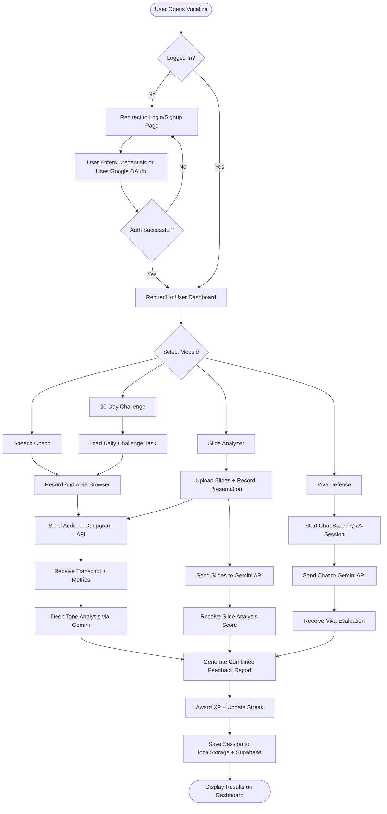

### 1.2 ABOUT THE UNIVERSITY / DEPARTMENT
*(Note: Update this section with your actual university and department details)*
This project is submitted as part of the academic curriculum for the B.Voc in Software Development program. The department focuses on practical skill development and software engineering principles, preparing students for the modern tech industry through hands-on project experience.

---

## CHAPTER 02: SYSTEM STUDY

### 2.1 AIMS AND OBJECTIVE OF PROJECT
The main goal for developing Vocalize is to provide a highly accessible platform where users can practice speaking and receive immediate, actionable feedback. The system reduces the dependency on human coaches and allows users to practice from their homes.

Key applications of Vocalize include:
1. **Speech Analysis:** Analyzing live speech for clarity, pacing, and filler word usage (including regional fillers like "matlab", "basically").
2. **Presentation Coaching:** Allowing users to upload PPTX or PDF slides and practice presenting them while AI evaluates both the slide content and the vocal delivery.
3. **Viva Defense Simulation:** Providing a chat-based Q&A environment where AI acts as an examiner with escalating difficulty.
4. **Progress Tracking:** Storing session history and generating visual reports and certificates for user retention.

### 2.2 TOOLS AND TECHNOLOGY

**Table 2.1: Technology Stack Used in Vocalize**

| Sr. No. | Technology / Tool | Category | Purpose in Project |
| :---: | :--- | :--- | :--- |
| 1 | Next.js 14.2.1 | Web Framework | Core frontend and backend framework with App Router for pages and API routes |
| 2 | TypeScript | Language | Static typing over JavaScript, reduces runtime bugs |
| 3 | Tailwind CSS 3.4.1 | Styling | Utility-first CSS for responsive UI design |
| 4 | Supabase | Auth + Database | User authentication (email, OAuth) and PostgreSQL database with RLS |
| 5 | Google Gemini 1.5 Flash | AI / ML | Text analysis, tone detection, slide evaluation, viva Q&A |
| 6 | Cerebras & Groq APIs | AI / ML | Primary ultra-fast fallback LLMs (llama-3.3-70b) |
| 7 | OpenRouter API | AI / ML | Safety-net fallback provider for free-tier model routing |
| 8 | Deepgram Nova-2 | AI / ML | Real-time speech-to-text transcription |
| 7 | MediaPipe | AI / ML | Client-side hand gesture recognition (GPU-accelerated in browser) |
| 8 | Razorpay | Payments | Subscription order creation and webhook-based payment verification |
| 9 | Resend | Email | Transactional emails for payment confirmations |
| 10 | ConvertAPI | File Processing | Server-side PPTX to PDF file conversion |
| 11 | pdf.js | File Processing | Client-side PDF rendering from CDN |
| 12 | JSZip | File Processing | PPTX XML parsing for text extraction |
| 13 | Recharts | Charts | Dashboard data visualization (line, area, pie charts) |
| 14 | jsPDF + html2canvas | PDF Export | Generating downloadable PDF reports from HTML |
| 15 | Sentry | Error Monitoring | Runtime error tracking and session replay |
| 16 | Jest + Playwright | Testing | Unit testing and end-to-end browser testing |

### 2.3 HARDWARE AND SOFTWARE COMPONENTS

**Table 2.2: Hardware Requirements**

| Component | Minimum Specification |
| :--- | :--- |
| Operating System | Windows 10 / macOS / Linux |
| Processor | Intel Core i3 or equivalent |
| RAM | 4 GB |
| Internet | Broadband connection (required for API calls) |
| Microphone | Built-in or external microphone |
| Webcam | Built-in or external webcam (for body language analysis) |
| Browser | Google Chrome 90+ or Microsoft Edge 90+ |

**Table 2.3: Software Requirements**

| Software | Version | Purpose |
| :--- | :--- | :--- |
| Node.js | >= 18.x | JavaScript runtime for development server |
| npm | >= 9.x | Package manager |
| Visual Studio Code | Latest | Primary code editor |
| Git | Latest | Version control |
| Postman | Latest | API testing during development |

### 2.4 FEASIBILITY STUDY

**Table 2.4: Feasibility Analysis Summary**

| Feasibility Type | Status | Justification |
| :--- | :---: | :--- |
| Technical | Feasible | Next.js handles frontend; AI processing offloaded to external APIs (no local GPU needed) |
| Operational | Feasible | Simple "click and record" interface; background processing is automatic |
| Economic | Feasible | Open-source stack (React, PostgreSQL); pay-as-you-go AI APIs; Razorpay subscription revenue covers costs |
| Schedule | Feasible | Modular development (Auth, AI, Gamification) allows iterative parallel work within academic timeline |

**1. Technical Feasibility:**
The project is highly feasible technically. The frontend is built on Next.js, which handles client-side rendering efficiently. AI processing is offloaded to external APIs (Gemini, Deepgram), meaning the local server does not need expensive GPU hardware to run machine learning models. 

**2. Operational Feasibility:**
The system is divided into clear modules (Dashboard, Speech Coach, PPT Coach). The user interface is straightforward, requiring users only to click 'Record' and speak. The background processing happens automatically, making it operationally simple for the end-user.

**3. Economic Feasibility:**
The project uses open-source tools like React and PostgreSQL. External AI APIs operate on a pay-as-you-go model. The integration of Razorpay allows the platform to collect subscription fees (Pro tier), which easily covers the server and API costs, making it economically self-sustaining.

**4. Schedule Feasibility:**
By dividing the project into independent modules (UI design, Auth integration, AI API connection, Gamification), the development followed an iterative approach, ensuring completion within the academic timeline.

### 2.5 SCOPE OF THE PROJECT
The scope of Vocalize covers automated communication training. It handles the complete lifecycle of a practice session: from recording audio/video to processing the data via AI, calculating scores, and updating user experience points.
**Out of Scope:** The platform currently does not support live human-to-human video tutoring or complex physical inventory management. It is strictly an AI-to-human coaching environment.

### 2.6 SIGNIFICANCE OF THE PROJECT
- **For Students:** Helps them prepare for academic vivas and job interviews without spending money on expensive coaching classes.
- **For Professionals:** Provides a tool to rehearse corporate presentations and improve body language.
- **For Academic Validation:** Showcases the successful integration of multiple external AI APIs, client-side browser APIs (MediaRecorder), and secure payment gateways within a modern web framework.

### 2.7 PROJECT PROFILE

**Table 2.5: Project Profile Summary**

| Parameter | Details |
| :--- | :--- |
| Project Title | Vocalize — AI-Powered Communication Coaching Platform |
| Developer | Gazi Abbas |
| Platform Type | Web-Based Application (Responsive) |
| Frontend Technologies | Next.js 14, TypeScript, Tailwind CSS |
| Backend Technology | Next.js API Routes (Node.js environment) |
| Database | PostgreSQL (via Supabase) |
| Primary Integrations | Google Gemini Flash, Deepgram Nova-2, Razorpay, ConvertAPI |

#### 2.7.1 User Roles and Responsibilities

**Table 2.6: User Roles and Responsibilities**

| Role | Access Level | Key Responsibilities |
| :--- | :--- | :--- |
| User | Standard | Register/Login, Record speeches, Upload presentations, Participate in viva sessions, View feedback reports, Track XP and streaks, Upgrade subscription |
| Admin | Elevated (email-gated) | Access admin dashboard, Monitor KPIs (users, revenue, sessions), View activity feeds, Manage users |

#### 2.7.2 Business Model
Vocalize operates on a Freemium SaaS (Software as a Service) business model.

**Table 2.7: Plan Comparison**

| Feature | Free Tier | Pro Tier (₹299/mo or ₹2,990/yr) |
| :--- | :---: | :---: |
| Speech Analyses / Month | 5 | Unlimited |
| PPT Analyses / Month | 3 | Unlimited |
| Viva Sessions / Month | 1 | 20 |
| Feedback Detail Level | Basic | Advanced |
| Priority Support | No | Yes |

#### 2.7.3 SWOT Analysis

**Table 2.8: SWOT Analysis of Vocalize**

| Category | Description |
| :--- | :--- |
| **Strengths** | Automated 24/7 availability; integration of multiple AI models (Gemini, Deepgram, MediaPipe); gamification engine that improves user retention; low infrastructure costs |
| **Weaknesses** | Requires a stable internet connection for API calls; relies on third-party AI services for core logic; no offline mode available |
| **Opportunities** | Can be integrated directly into university portals or corporate training programs as a B2B service; growing demand for soft-skill training tools |
| **Threats** | Fast-paced changes in AI model APIs may require frequent updates; competition from other emerging AI ed-tech platforms; API pricing changes by providers |

---

## CHAPTER 03: SOFTWARE REQUIREMENT SPECIFICATION

### 3.1 FUNCTIONAL REQUIREMENTS

**Table 3.1: Functional Requirements — User Module**

| Req. ID | Requirement | Description | Priority |
| :---: | :--- | :--- | :---: |
| FR-01 | User Registration | Users must sign up via email/password or Google OAuth | High |
| FR-02 | User Login | Secure login with session persistence | High |
| FR-03 | Password Recovery | Email-based forgot/reset password flow | Medium |
| FR-04 | Speech Recording | Record audio/video from browser using MediaRecorder API | High |
| FR-05 | Speech Transcription | Send audio to Deepgram; display transcript with WPM and filler count | High |
| FR-06 | Deep Tone Analysis | Send transcript to Gemini for confidence and tone scoring | High |
| FR-07 | Slide Upload | Accept PDF and PPTX files via drag-and-drop | High |
| FR-08 | Slide Conversion | Convert PPTX to PDF using ConvertAPI | Medium |
| FR-09 | Slide Analysis | Evaluate slide content, design, and storytelling via Gemini | High |
| FR-10 | Body Language Analysis | Extract video frames and analyze posture via Gemini Vision | Medium |
| FR-11 | Viva Defense | Chat-based Q&A simulation with escalating difficulty | High |
| FR-12 | XP & Leveling | Award XP based on session performance; track user levels | Medium |
| FR-13 | Streak Tracking | Daily streak tracking with streak freeze mechanic | Medium |
| FR-14 | Badge Unlocking | Automatic badge check after each session | Low |
| FR-15 | PDF Report Export | Generate downloadable PDF reports using jsPDF + html2canvas | Medium |
| FR-16 | Subscription Payment | Razorpay checkout for Pro plan upgrade | High |

**Table 3.2: Functional Requirements — Admin Module**

| Req. ID | Requirement | Description | Priority |
| :---: | :--- | :--- | :---: |
| FR-17 | Admin Login | Email whitelist-based admin authentication | High |
| FR-18 | KPI Dashboard | Display total users, revenue, and session counts | High |
| FR-19 | Data Charts | User growth, revenue trends, and module usage charts | Medium |
| FR-20 | Activity Feed | Real-time admin activity log | Low |

### 3.2 NON-FUNCTIONAL REQUIREMENTS

**Table 3.3: Non-Functional Requirements**

| NFR ID | Category | Requirement |
| :---: | :--- | :--- |
| NFR-01 | Performance | Audio transcription results returned within 5 seconds |
| NFR-02 | Security | All passwords hashed by Supabase Auth; API keys stored server-side only |
| NFR-03 | Security | Row Level Security (RLS) on all database tables |
| NFR-04 | Reliability | External API calls wrapped in fetchWithRetry (exponential backoff, 5 retries) |
| NFR-05 | Scalability | Stateless API routes; client-side storage for instant UI response |
| NFR-06 | Usability | Responsive design for desktop and mobile screens |
| NFR-07 | Availability | 99.9% uptime target (dependent on Supabase and AI provider SLAs) |

### 3.3 USE CASE DIAGRAM

**Figure 3.1: Use Case Diagram — Vocalize Platform**

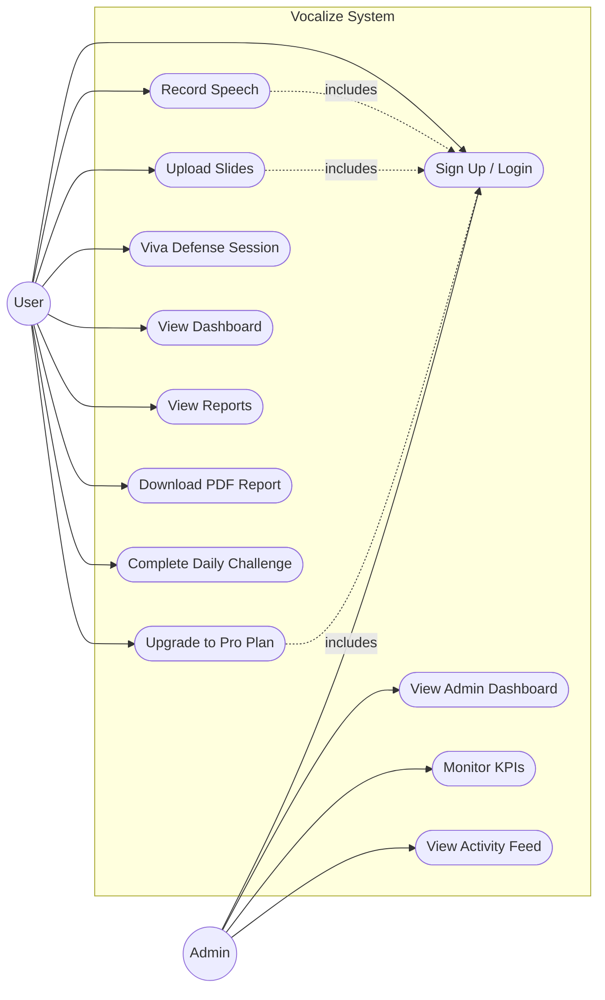

---

## CHAPTER 04: SYSTEM DESIGN

### 4.1 SYSTEM ARCHITECTURE

The system uses a three-tier client-server architecture where the browser handles UI and media capture, the Next.js API layer handles secure API orchestration, and Supabase handles persistent data.

**Figure 4.1: System Architecture Diagram**

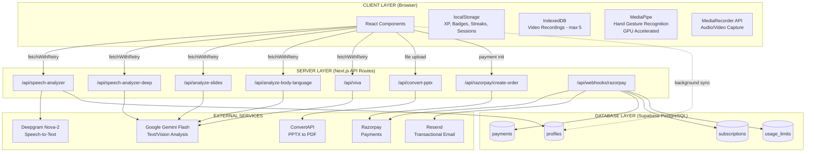

### 4.2 DATA FLOW DIAGRAM (DFD)

**Figure 4.2: Level-0 DFD (Context Diagram)**

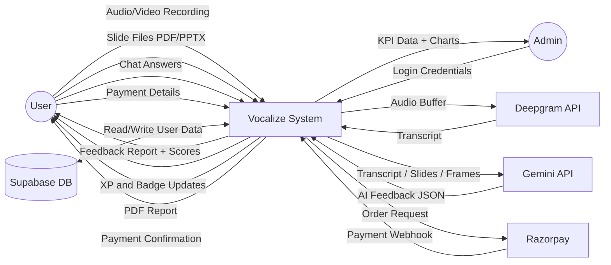

**Figure 4.3: Level-1 DFD (Detailed Processes)**

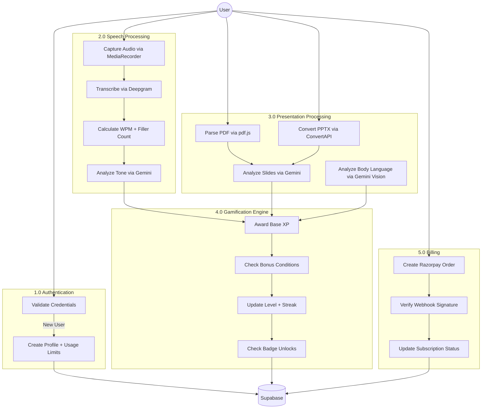

### 4.3 ENTITY RELATIONSHIP (ER) DIAGRAM

**Figure 4.4: ER Diagram — Vocalize Database**

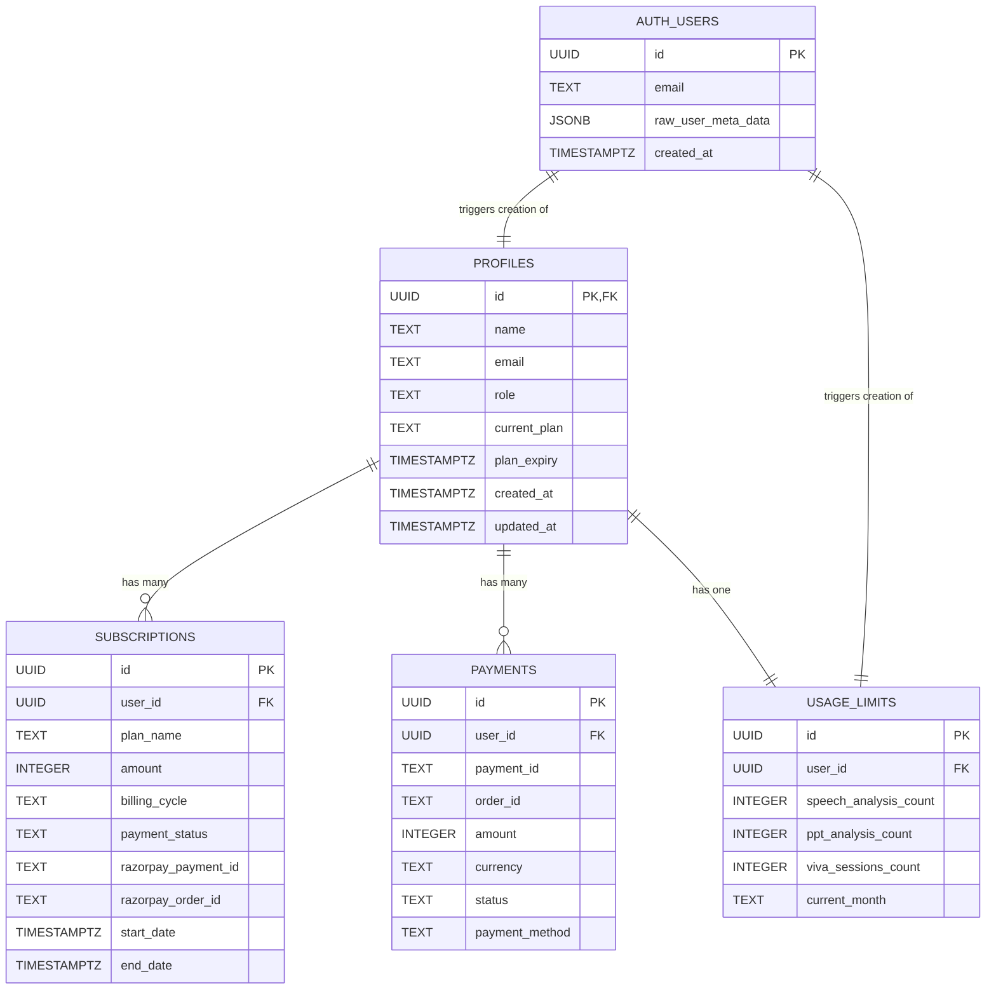

### 4.4 ALGORITHMS & LOGIC

**Algorithm 1: Speech Analysis Processing**

**Figure 4.5: Flowchart — Speech Analysis Algorithm**

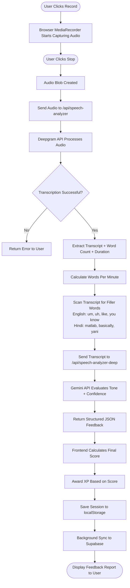

**Algorithm 2: Gamification XP Calculation**

**Figure 4.6: Flowchart — XP Calculation Algorithm**

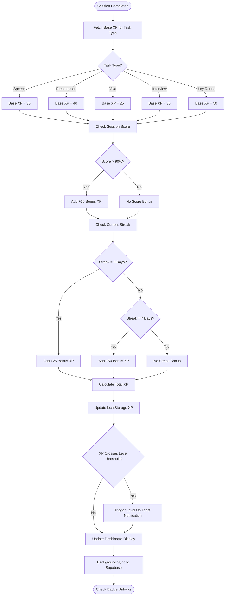

**Table 4.1: XP Award Structure**

| Activity Type | Base XP | High Score Bonus (>90%) | 3-Day Streak | 7-Day Streak | Badge Unlock |
| :--- | :---: | :---: | :---: | :---: | :---: |
| Speech Session | 30 | +15 | +25 | +50 | +100 |
| Presentation | 40 | +15 | +25 | +50 | +100 |
| Viva Session | 25 | +15 | +25 | +50 | +100 |
| Interview | 35 | +15 | +25 | +50 | +100 |
| Jury Round | 50 | +15 | +25 | +50 | +100 |

**Table 4.2: Level Progression System**

| Level | Title | XP Required | XP Range |
| :---: | :--- | :---: | :--- |
| 1 | Beginner Speaker | 0 XP | 0 – 199 |
| 2 | Rising Communicator | 200 XP | 200 – 599 |
| 3 | Confident Presenter | 600 XP | 600 – 1199 |
| 4 | Skilled Orator | 1200 XP | 1200 – 1999 |
| 5 | Vocalize Master | 2000 XP | 2000+ |

### 4.5 DATA DICTIONARY

**Table 4.3: Data Dictionary — profiles**

| Column Name | Data Type | Constraints | Description |
| :--- | :--- | :--- | :--- |
| id | UUID | PRIMARY KEY, FK to auth.users | Unique user identifier |
| name | TEXT | NOT NULL | User display name |
| email | TEXT | NOT NULL | Registered email address |
| role | TEXT | DEFAULT 'user' | User role (user / admin) |
| current_plan | TEXT | DEFAULT 'free' | Active plan (free / pro / premium / team) |
| plan_expiry | TIMESTAMPTZ | NULLABLE | Subscription expiration date |
| created_at | TIMESTAMPTZ | DEFAULT now() | Account creation timestamp |
| updated_at | TIMESTAMPTZ | DEFAULT now() | Last profile update timestamp |

**Table 4.4: Data Dictionary — subscriptions**

| Column Name | Data Type | Constraints | Description |
| :--- | :--- | :--- | :--- |
| id | UUID | PRIMARY KEY | Unique subscription ID |
| user_id | UUID | FK to profiles.id | Owner of the subscription |
| plan_name | TEXT | NOT NULL | Plan identifier (pro, premium) |
| amount | INTEGER | NOT NULL | Payment amount in paise |
| billing_cycle | TEXT | NOT NULL | monthly or yearly |
| payment_status | TEXT | NOT NULL | pending / active / cancelled |
| razorpay_payment_id | TEXT | NULLABLE | Razorpay transaction reference |
| razorpay_order_id | TEXT | NULLABLE | Razorpay order reference |
| start_date | TIMESTAMPTZ | NOT NULL | Subscription start date |
| end_date | TIMESTAMPTZ | NOT NULL | Subscription end date |

**Table 4.5: Data Dictionary — payments**

| Column Name | Data Type | Constraints | Description |
| :--- | :--- | :--- | :--- |
| id | UUID | PRIMARY KEY | Unique payment record ID |
| user_id | UUID | FK to profiles.id | Paying user |
| payment_id | TEXT | NOT NULL | External payment reference |
| order_id | TEXT | NOT NULL | External order reference |
| amount | INTEGER | NOT NULL | Amount captured (in paise) |
| currency | TEXT | DEFAULT 'INR' | Currency code |
| status | TEXT | NOT NULL | captured / failed |
| payment_method | TEXT | NULLABLE | UPI / card / netbanking |

**Table 4.6: Data Dictionary — usage_limits**

| Column Name | Data Type | Constraints | Description |
| :--- | :--- | :--- | :--- |
| id | UUID | PRIMARY KEY | Unique record ID |
| user_id | UUID | FK to profiles.id | User whose limits are tracked |
| speech_analysis_count | INTEGER | DEFAULT 5 | Remaining speech analyses this month |
| ppt_analysis_count | INTEGER | DEFAULT 3 | Remaining PPT analyses this month |
| viva_sessions_count | INTEGER | DEFAULT 1 | Remaining viva sessions this month |
| current_month | TEXT | NOT NULL | Month identifier for auto-reset |

### 4.6 PAYMENT FLOW

**Figure 4.7: Flowchart — Razorpay Payment Processing**

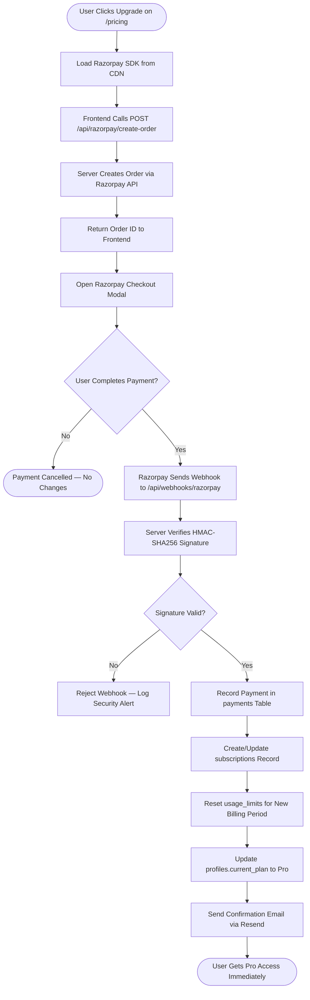

### 4.7 AUTHENTICATION FLOW

**Figure 4.8: Flowchart — User Authentication Process**

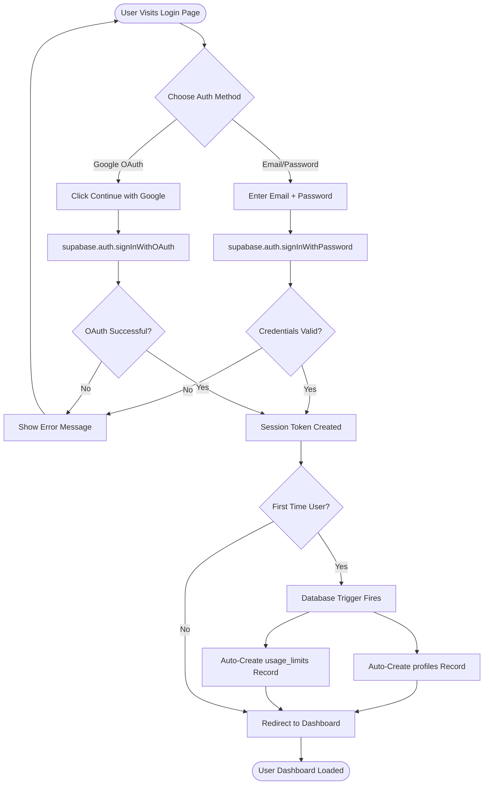

---

## CHAPTER 05: IMPLEMENTATION

### 5.1 INTRODUCTION
The Implementation phase translates the architecture and database design into functional code. The project was built using a component-based approach with Next.js App Router. Independent modules such as authentication, MediaPipe gesture tracking, and Razorpay billing were developed and tested in isolation before being integrated into the main dashboard.

### 5.2 DEVELOPMENT ENVIRONMENT

**Table 5.1: Development Environment Setup**

| Component | Tool / Service | Details |
| :--- | :--- | :--- |
| Code Editor | Visual Studio Code | TypeScript + React extensions |
| Runtime | Node.js 18+ | Next.js development server on localhost:3000 |
| API Testing | Postman + Browser DevTools | JSON payload inspection for Gemini and Deepgram |
| Version Control | Git | Codebase history and branch management |
| Database Console | Supabase Dashboard | SQL editor, table viewer, auth management |
| Package Manager | npm | Dependency installation and script execution |

### 5.3 MODULE IMPLEMENTATION

#### 5.3.1 User Registration & Authentication Module
Authentication is managed via Supabase Auth. 
- **Implementation:** A split-screen UI captures the user's email and password. A database trigger (`on_auth_user_created`) automatically creates a corresponding record in the `profiles` and `usage_limits` tables whenever a new user signs up.

#### 5.3.2 Speech & Audio Processing Module
- **Implementation:** The `sessionRecorder.ts` utility handles the browser's `MediaRecorder` API. Once a session ends, the audio file is converted into a base64 buffer and sent to the custom backend route `/api/speech-analyzer`. The backend communicates with Deepgram to get highly accurate transcripts and then passes the text to Google Gemini to retrieve subjective feedback on communication style.

#### 5.3.3 Slide Parsing & Presentation Module
- **Implementation:** Users upload files via a drag-and-drop zone. If a PDF is uploaded, it is parsed locally using the `pdf.js` library via CDN. If a PPTX is uploaded, a backend route (`/api/convert-pptx`) uses the ConvertAPI service to securely transform the presentation into a readable PDF format. Slide text is extracted and analyzed against the spoken words to verify content delivery.

**Figure 5.1: Flowchart — Slide Upload and Processing**

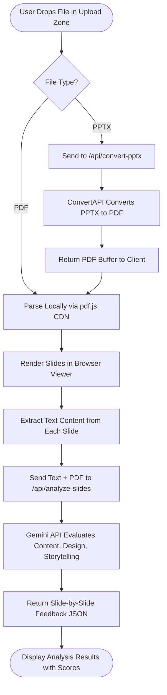

#### 5.3.4 Billing & Subscription Engine
- **Implementation:** The pricing page allows users to upgrade to Pro. When a user clicks pay, the `razorpay.ts` utility initializes the Razorpay checkout overlay. Upon payment completion, Razorpay fires a background server-to-server webhook to `/api/webhooks/razorpay`. The backend verifies the HMAC-SHA256 signature to prevent fraud, logs the transaction in the `payments` table, and upgrades the user's `current_plan` in the database.

### 5.4 API ROUTES

**Table 5.2: API Endpoint Reference**

| Route | Method | AI Service | Purpose |
| :--- | :---: | :--- | :--- |
| /api/speech-analyzer | POST | Deepgram Nova-2 | Audio transcription, WPM, filler detection |
| /api/speech-analyzer-deep | POST | Gemini Flash | Deep tone and confidence analysis from transcript |
| /api/analyze-slides | POST | Gemini Flash | Slide deck analysis (content, design, storytelling) |
| /api/analyze-body-language | POST | Gemini Vision | Body language analysis from extracted video frames |
| /api/viva | POST | Gemini Flash | Viva Q&A simulation with escalating difficulty |
| /api/convert-pptx | POST | ConvertAPI | PPTX to PDF file conversion |
| /api/razorpay/create-order | POST | Razorpay | Create payment order for subscription |
| /api/webhooks/razorpay | POST | — | Handle payment captured/failed webhook events |
| /api/make-admin | POST | — | Admin role assignment (protected) |

### 5.5 INPUT CODING (SAMPLES)

**Database Trigger for Automatic Profile Creation (Supabase SQL):**
```sql
CREATE FUNCTION handle_new_user() RETURNS trigger AS $$
BEGIN
  INSERT INTO public.profiles (id, email, name, role, current_plan)
  VALUES (new.id, new.email, new.raw_user_meta_data->>'full_name', 'user', 'free');
  
  INSERT INTO public.usage_limits (user_id, speech_analysis_count, ppt_analysis_count, viva_sessions_count)
  VALUES (new.id, 5, 3, 1);
  RETURN new;
END;
$$ LANGUAGE plpgsql SECURITY DEFINER;

CREATE TRIGGER on_auth_user_created
  AFTER INSERT ON auth.users
  FOR EACH ROW EXECUTE FUNCTION handle_new_user();
```

**Retry Logic for API Calls (fetchWithRetry.ts):**
```typescript
export async function fetchWithRetry(url: string, options: RequestInit, retries = 3) {
  for (let i = 0; i < retries; i++) {
    try {
      const response = await fetch(url, options);
      if (response.ok) return response;
    } catch (error) {
      if (i === retries - 1) throw error;
      await new Promise(res => setTimeout(res, 1000 * Math.pow(2, i))); // Exponential backoff
    }
  }
}
```

### 5.6 COMPONENT REFERENCE

**Table 5.3: Key UI Components**

| Component | File Location | Purpose |
| :--- | :--- | :--- |
| SidebarLayout | components/SidebarLayout.tsx | Main navigation bar with dropdown menus, mobile responsive |
| ConfidenceGraph | components/ConfidenceGraph.tsx | Time-series line/area chart with event markers (Recharts) |
| CertificateModal | components/CertificateModal.tsx | Printable badge achievement certificate |
| XPBar | components/XPBar.tsx | XP progress bar display |
| XPToast | components/XPToast.tsx | Level-up notification toast |
| BadgeGrid | components/BadgeGrid.tsx | Badge collection grid display |
| StreakBadge | components/StreakBadge.tsx | Streak counter in navbar |
| LiveAlert | components/LiveAlert.tsx | Real-time coaching alerts during sessions |
| ImprovementRoadmap | components/ImprovementRoadmap.tsx | Improvement plan visualization |
| RecommendationCard | components/RecommendationCard.tsx | AI recommendation display card |
| JuryAvatar | components/JuryAvatar.tsx | Avatar for jury simulation mode |
| UpgradeModal | components/UpgradeModal.tsx | Plan upgrade prompt modal |
| ScribbleLoader | components/ScribbleLoader.tsx | Loading animation component |
| ScrollReveal | components/ScrollReveal.tsx | Scroll-triggered animation wrapper |
| Footer | components/Footer.tsx | Site-wide footer |

### 5.7 OUTPUT SCREENSHOTS
*(Note: Insert actual project screenshots here during final printing)*
1. **Landing Page:** Displays the value proposition and login entry points.
2. **User Dashboard:** Shows the user's current Level, XP Bar, 20-Day Challenge progress, and Recent Sessions.
3. **Speech Coach Interface:** Shows the live recording state with dynamic audio wave animations.
4. **Feedback Report:** Displays the calculated Confidence Score, Word Per Minute chart, and itemized AI suggestions.

### 5.8 TESTING AND DEBUGGING

**Table 5.4: Testing Strategy**

| Testing Type | Tool Used | Scope | Location |
| :--- | :--- | :--- | :--- |
| Unit Testing | Jest + React Testing Library | Core utility functions (XP logic, storage, gamification) | src/lib/__tests__/ |
| End-to-End Testing | Playwright (Chromium) | Full user flows: login, navigation, module interaction | tests/ |
| Error Monitoring | Sentry (@sentry/nextjs) | Runtime exception logging, session replay, performance | Client + Server |
| Manual Testing | Browser DevTools + Postman | API payload inspection, network debugging | During development |

### 5.9 SECURITY IMPLEMENTATION

**Table 5.5: Security Measures Implemented**

| Security Measure | Implementation Detail |
| :--- | :--- |
| API Key Protection | All keys (Gemini, Deepgram, Razorpay Secret) in server-only .env.local variables; never in client bundle |
| Row Level Security (RLS) | Supabase RLS policies on all tables; users can only access rows matching their auth session |
| Payment Verification | HMAC-SHA256 signature recalculation on Razorpay webhook payloads to prevent forged requests |
| Auth Session Management | Supabase handles JWT token issuance, refresh, and expiry automatically |
| Admin Access Control | Admin dashboard gated by hardcoded email whitelist; sessionStorage flag for persistence |
| Input Validation | Server-side validation on all API route inputs before processing |

---

## CHAPTER 06: CONCLUSION
The design, development, and implementation of Vocalize have been completed successfully, meeting the specified functional requirements. The project serves as a functional, production-ready educational technology platform that directly addresses the gap in accessible communication coaching. 

By integrating Next.js for a robust user interface and utilizing modern AI models for backend logic, the platform automates the complex task of evaluating human speech and body language. The implementation of gamification mechanics successfully mimics the engagement loops of modern learning applications, ensuring users remain motivated to practice. Overall, Vocalize demonstrates how cloud-based AI tools and modern web frameworks can be combined to build highly scalable, impactful applications that solve real-world self-improvement challenges.

---

## CHAPTER 07: FUTURE ENHANCEMENT

**Table 7.1: Proposed Future Enhancements**

| Sr. No. | Enhancement | Description | Expected Impact |
| :---: | :--- | :--- | :--- |
| 1 | Native Mobile App | React Native or Flutter app with push notification support for daily reminders | Wider reach; practice on the go |
| 2 | Realistic AI Avatars | 3D animated interviewers during Viva module using web rendering engines | Increased realism and user pressure simulation |
| 3 | B2B University Portal | Admin portals for professors to assign prompts and track class performance | Enterprise revenue stream; institutional adoption |
| 4 | Offline Mode | Cache-first approach with service workers for basic features without internet | Usability in low-connectivity areas |
| 5 | Multi-Language Expansion | Expand beyond English/Hindi to support regional Indian languages | Broader user demographic |

---

## CHAPTER 08: BIBLIOGRAPHY
The architecture and development of this project were guided by the following resources:

**Table 8.1: References**

| Sr. No. | Source | URL / Publisher | Usage |
| :---: | :--- | :--- | :--- |
| 1 | Next.js Official Documentation | nextjs.org/docs | Routing, server components, API endpoint construction |
| 2 | Supabase Documentation | supabase.com/docs | Authentication, database triggers, Row Level Security policies |
| 3 | Deepgram API References | deepgram.com/docs | Audio buffer streaming, multi-language speech-to-text |
| 4 | Google AI Studio Docs | ai.google.dev | Prompt engineering for Gemini Flash and Vision models |
| 5 | Razorpay Developer Portal | razorpay.com/docs | Checkout gateway integration, HMAC webhook validation |
| 6 | MediaPipe Documentation | mediapipe.dev | Hand gesture recognition task setup |
| 7 | Tailwind CSS Docs | tailwindcss.com/docs | Utility class reference for responsive UI design |
| 8 | Recharts Documentation | recharts.org | Chart component configuration for dashboard |

---

## USER MANUAL

**Step 1: Account Registration**
- Open the Vocalize portal in your web browser.
- Click "Sign Up" and enter your Full Name, Email, and a secure password. Alternatively, use the "Continue with Google" button.
- Once registered, you will be redirected to the main User Dashboard.

**Step 2: Using the Speech Coach**
- Click on "Speech Coach" from the sidebar.
- Allow the browser permission to access your microphone and camera.
- Click the "Start Recording" button and begin speaking. 
- When finished, click "Stop". The system will process your recording and immediately generate a feedback report detailing your pacing, filler words, and confidence.

**Step 3: Tracking Progress (Gamification)**
- Your Dashboard displays your current Level and Total XP.
- Complete sessions daily to build your "Streak".
- Navigate to the "Reports" tab to view history and click "Download PDF" to save a copy of your session feedback.

**Step 4: Upgrading Subscription**
- Click on "Pricing" in the menu.
- Review the Pro tier benefits and click "Upgrade".
- A Razorpay payment window will appear. Select your preferred method (UPI, Card, NetBanking) and complete the transaction to instantly unlock unlimited analyses.

**Figure U.1: User Navigation Flow**

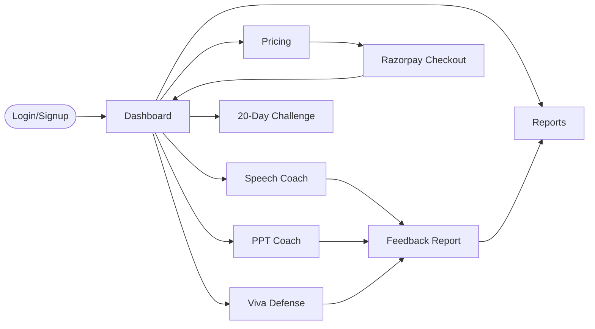

---

## MAJOR PROJECT DAILY DIARY
**Project Name:** Vocalize

**Table D.1: Weekly Development Diary**

| Week | Dates (Approx.) | Implementation / Task Executed |
| :---: | :--- | :--- |
| **Week 1** | Week 1 | Studied project requirements, finalized the problem statement, and designed initial UI wireframes. Initialized the Next.js 14 project repository and configured Tailwind CSS. |
| **Week 2** | Week 2 | Set up the Supabase database. Designed relational schemas for profiles and usage limits. Implemented secure user authentication (Login/Signup/OAuth) and protected routes. |
| **Week 3** | Week 3 | Developed the Speech Coach module. Integrated the browser MediaRecorder API and established backend connections with the Deepgram API for real-time speech-to-text. |
| **Week 4** | Week 4 | Integrated Google Gemini API for deep tone analysis. Built the PPT Coach feature, implementing ConvertAPI for handling presentation file conversions and slide parsing. |
| **Week 5** | Week 5 | Developed the gamification engine using local storage and background database syncing. Programmed XP calculation logic, streak tracking, and achievement badge unlocking mechanisms. |
| **Week 6** | Week 6 | Built the billing engine. Integrated Razorpay SDK for client-side checkout and configured server-side webhooks to automatically update user subscription states upon payment. |
| **Week 7** | Week 7 | Finalized the user interface and responsive layouts. Conducted unit and end-to-end testing using Playwright. Fixed runtime bugs and generated final project documentation. |

--- 
*End of Document*
