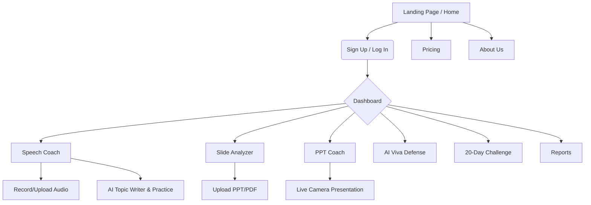

# Vocalize - UI Workflow & Visual Architecture

This document outlines the standard UI workflow, visual architecture, and design system of the Vocalize application. You can share this with other cloud services or designers to help them understand the current UI layout and suggest improvements.

## 1. Global Design System (Corporate Minimal)

The application follows a "Corporate Minimal" aesthetic that emphasizes clean lines, high contrast, and accessibility.

*   **Typography:**
    *   **Sans-serif (Primary):** `Inter` (used for body text, inputs, buttons)
    *   **Heading:** `Space Grotesk` (used for major hero sections or stylized titles)
    *   **Handwriting (Accent):** `Caveat` (used sparingly for human-like accents)
*   **Color Palette:**
    *   **Primary/Brand:** `slate-900` (#0f172a) - Used for primary buttons, logos, and active states.
    *   **Backgrounds:** `slate-50` (#f8fafc) for main app backgrounds, `white` (#ffffff) for cards and modals.
    *   **Accents:** `rose`, `amber`, `emerald`, `indigo`, `blue` (Used strictly for contextual actions, success/error states, and specific product icons).
*   **UI Components:**
    *   **Buttons:** Fully rounded (`rounded-xl`), slight shadow, scale down on click (`active:scale-[0.99]`), with high-contrast focus rings (`focus-visible:ring-2 focus-visible:ring-slate-900`).
    *   **Inputs:** `min-h-[44px]` for touch targets, `slate-200` borders, `focus:ring-slate-900/10` subtle rings.
    *   **Animations:** Use CSS `page-enter` transitions for smooth routing. `animate-pulse` for skeleton loading states.

---

## 2. Sitemap & Application Workflow

---

## 3. Core Page Workflows

### A. The Dashboard (User Home)
*   **Visual Layout:** Top navbar with user profile dropdown and global navigation. Main content area features a clean greeting ("Welcome back"), a dynamic User Profile card, and a grid of "Your Progress" metric cards (Score, Streak, Level, Freezes).
*   **Behavior:** Uses a skeleton loading state (`animate-pulse`) while fetching user data. If no history exists, an Empty State graphic is shown. 

### B. Speech Coach (`/speech-coach`)
*   **Visual Layout:** Split into two main tabs/flows.
    1.  **Audio/Video/Upload:** A clean drag-and-drop zone with a pulsing microphone button for live recording.
    2.  **AI Topic Writer:** A vibrant hero banner to input a topic, followed by an AI-generated speech viewer. Users can edit the script inline or practice speaking it side-by-side with a recording button.
*   **Results View:** Displays a deep-dive analysis dashboard featuring an interactive Audio Player with clickable timestamp markers (Strengths, Weaknesses, Suggestions), a full transcript, and pacing/filler metrics.

### C. Sidebar & Navigation (`SidebarLayout`)
*   **Desktop:** A sleek, sticky top navigation bar (frosted glass effect `backdrop-blur-lg`) on inner pages. Includes a dropdown for Products and Support. Dropdowns are click-based for accessibility, featuring smooth `opacity` and `translate-y` transitions.
*   **Mobile:** A hamburger menu that expands into a full-width overlay, keeping the UI uncluttered.

### D. Authentication (`/login`, `/signup`)
*   **Visual Layout:** A split-screen design. One side features the clean, corporate-minimal authentication form (no neon glows, strictly slate borders). The other side features a rotating set of testimonials or feature highlights to reinforce value.

---

## 4. Areas for UI/UX Improvement (For Cloud/Designers)
When passing this to a cloud service for improvement, consider asking them to focus on:
1.  **Data Visualization:** Enhancing how the Speech Coach results (pacing, filler words) are graphed using libraries like Recharts.
2.  **Gamification UI:** Improving the visual celebration (confetti, badges) in the 20-Day Challenge section.
3.  **Responsive Dense Data:** How to better display the long list of "Timestamp Coaching Suggestions" on smaller mobile screens without overwhelming the user.
